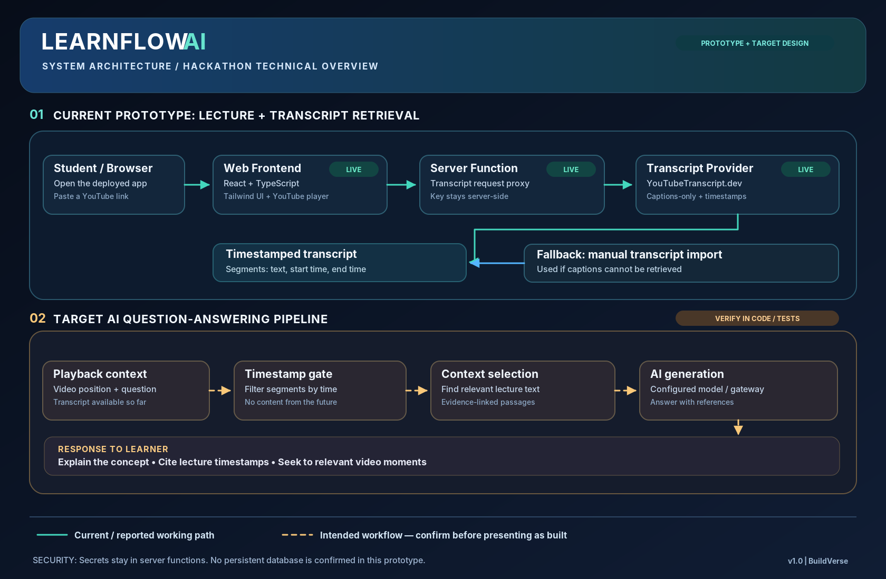

# LearnFlow AI — System Architecture

[Full-resolution PNG](docs/architecture.png) · [Editable vector SVG](docs/architecture.svg)

## Scope and status legend

- **Solid teal:** Reported working prototype — browser, React/TypeScript UI, backend transcript request, and YouTubeTranscript.dev captions; fallback import is available.
- **Dashed amber:** Intended or partially developed learning workflow requiring code review and live functional tests before being described as complete.

## Component responsibilities

| Component | Responsibility | Current status |
| :-- | :-- | :-- |
| Learner/browser | Loads the published web application and initiates lecture session | Working app reported |
| React/TypeScript frontend | Displays lecture, user controls, transcript, and learning interface | Working app reported |
| Server-side transcript function | Calls transcript provider without placing secret in browser | Previously reported working |
| YouTubeTranscript.dev | Returns caption text and timestamps for captioned videos | Previously reported working |
| Manual transcript import | Provides fallback if automatic retrieval fails | Previously reported available |
| Timestamp gate | Limits retrieval to positions at/before the current playback timestamp | Verify implementation and tests |
| Context selection | Selects relevant passages from permitted segments | Verify implementation and tests |
| AI generation | Produces lecture-grounded answer and referenced timestamps | Verify implementation and provider |

## Current flow

1. Learner opens LearnFlow AI and selects a lecture.
2. Web client displays the YouTube player.
3. Backend code requests caption segments from YouTubeTranscript.dev using a server-side credential.
4. Timestamped captions are returned and used by the learning workspace.
5. If captions are unavailable, the manual import route can be used.

## Target playback-aware Q&A

1. Capture the learner's question and the **current** video time `t`.
2. Admit only transcript segments ending at or before `t` (and decide how to handle a segment that straddles the boundary).
3. Retrieve passages relevant to the question **from that admitted subset**.
4. Send selected passages to the AI model with clear instructions to avoid answering beyond the provided evidence.
5. Display an answer with grounded timestamp citations, or indicate that the content is not yet covered.

> Applying filtering **before** AI context assembly is essential. UI-only blurring of future transcript content is not an adequate content boundary. The diagram shows the intended mechanism, **not proof it has been implemented**.

## Security & operational notes

- Keep `YOUTUBE_TRANSCRIPT_DEV_API_KEY` in the server's secrets configuration.
- Validate YouTube video IDs and handle malformed input gracefully.
- Rate-limit outbound calls; avoid repeated requests for the same video and handle `429` responses.
- An in-memory cache may reduce repeat retrieval but is not durable persistent storage.
- Persistent database provisioning is **not confirmed** for this prototype.
- For a deployed release, test captionless videos, invalid inputs, external errors, source grounding, timestamp leakage, and citation accuracy.

## Judge walkthrough

**30-second explanation:** "LearnFlow AI embeds a YouTube lecture in a React interface. A server-side function retrieves timed captions through YouTubeTranscript.dev, while keeping API secrets off the client. Our playback-aware design then aims to restrict AI context to the part of the lecture already watched and return answers linked to relevant timestamps. The diagram distinguishes the live transcript pipeline from the AI components we are still validating."
